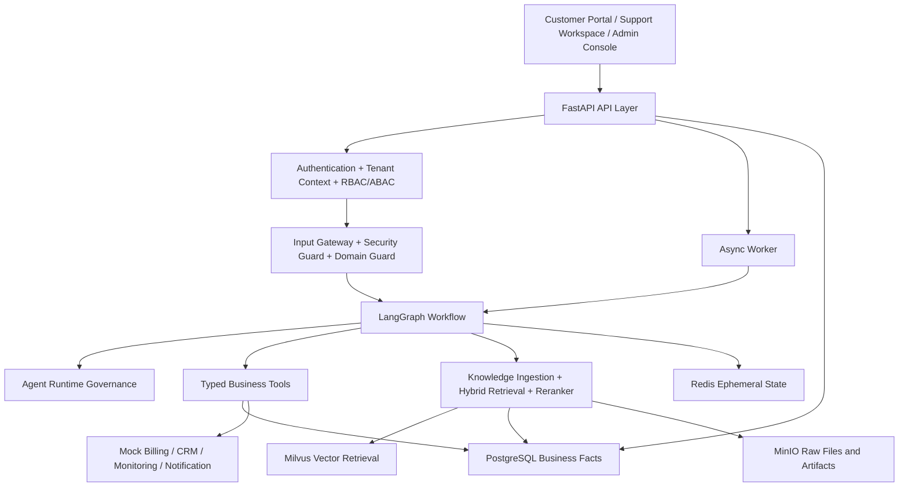
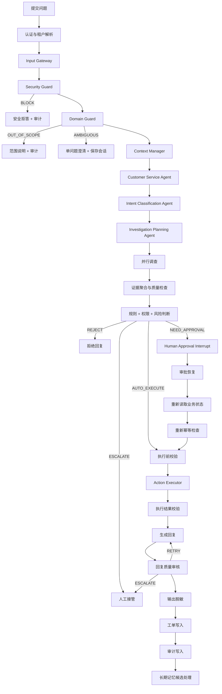
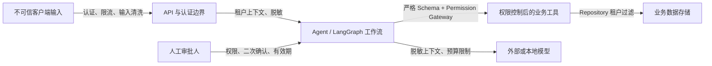

# CloudDesk 企业级智能客服与工单处理 Agent 平台

## Phase 1 系统设计

- 项目路径：`E:\ai\enterprise-customer-operations-platform`
- 设计日期：2026-08-01
- 当前阶段：Phase 1——需求与架构
- 文档状态：已完成设计，等待用户审阅
- 项目边界：完全独立于 `E:\ai\EduAgent完整代码`

## 1. 项目定位

CloudDesk 是一家提供企业协作 SaaS 的模拟企业。平台为多个企业租户提供账户、成员权限、订阅计费、支付、API、技术支持、SLA 和工单服务。

本项目建设一个可运行、可测试、可部署的企业级客服与工单处理 Agent 平台。平台不是单纯聊天机器人，而是通过安全检查、租户识别、知识检索、业务调查、规则决策、人工审批、动作执行、工单处理、审计和长期记忆形成完整客户服务闭环。

第一阶段以“重复扣费与退款”作为端到端垂直业务链，之后扩展账户管理、技术支持、SLA 和工单运营。

所有支付、CRM、监控和通知系统均使用项目内 Mock Service，不连接真实生产系统，不处理真实资金，不使用真实客户数据。

## 2. 业务边界

### 2.1 支持的业务域

- Billing：重复扣费、退款、支付失败、发票、订阅和账单异常。
- Account Management：登录、账户锁定、MFA、成员、角色和权限。
- Technical Support：API、服务可用性、性能、同步、Webhook、集成和文件上传。
- Enterprise SLA：支持等级、故障升级、赔偿规则和紧急事件。
- Ticket Operations：创建、查询、补充、催办、关闭、重开和转派工单。

### 2.2 第一条端到端闭环

```text
重复扣费问题
→ 安全检查
→ 租户与用户识别
→ 意图识别
→ PostgreSQL 查询支付事实
→ Milvus 检索退款政策
→ BGE-M3 Dense + Sparse 混合检索
→ Cross-Encoder 精排
→ 规则与权限判断
→ 自动退款或人工审批
→ 审批后重新校验状态
→ 幂等执行
→ 回复生成与审核
→ 创建或更新工单
→ 写入审计日志
→ 提取合规长期记忆
```

### 2.3 非目标

- 不接入真实支付渠道、ERP、CRM 或客户生产系统。
- 不使用真实客户数据、真实凭据或真实银行卡信息。
- 不让 LLM 直接生成或执行 SQL。
- 不向前端暴露 Chain of Thought、系统 Prompt、内部密钥或未脱敏 Trace。
- 不把所有工作流节点都包装成 Agent。
- 不在第一阶段拆分为大量核心微服务。

## 3. 用户角色

| 角色 | 主要职责 |
| --- | --- |
| `customer_user` | 提交问题、查询工单、补充信息 |
| `customer_admin` | 管理企业成员，查看企业订阅和账单 |
| `support_agent` | 查看客户资料、调查证据、处理工单 |
| `support_manager` | 审批高风险操作、转派和升级 |
| `finance_reviewer` | 审核退款、账单和支付争议 |
| `technical_engineer` | 处理 API、集成和服务故障 |
| `tenant_admin` | 管理本租户成员、知识库和配置 |
| `platform_admin` | 管理租户、Agent、模型、Prompt、评测和审计 |

## 4. 总体架构

采用“模块化单体 + 独立 Worker”的架构，并以垂直业务链作为实施顺序。



### 4.1 LangChain 与 LangGraph 边界

LangChain 负责：

- Chat Model 初始化与调用。
- PromptTemplate、Structured Output 和 Output Parser。
- Tool Schema、Retriever、Embedding 和 Reranker 封装。
- Model Router 的模型适配。

LangGraph 负责：

- 节点编排、State、条件边和并行分支。
- Checkpoint、Interrupt、Resume 和错误路由。
- Human-in-the-loop、子图和工作流终止条件。

### 4.2 模块边界

- `domain`：领域实体、值对象、状态机和业务规则接口，不依赖 FastAPI、LangChain 或数据库。
- `application`：业务用例和事务边界。
- `graph`：LangGraph 图构建、State、Reducer、Router 和 Checkpoint。
- `agents`：需要大模型进行判断、规划或生成的 Agent。
- `nodes`：确定性节点和工作流节点适配器。
- `runtime`：Agent Registry、Model Router、Prompt Registry、Budget、Trace、Cost 和 Feature Flags。
- `rag`：文档导入、切片、Embedding、Milvus、Hybrid Retrieval 和 Reranker。
- `tools`：严格 Pydantic Schema、权限检查、幂等、限流和 Mock Service 适配器。
- `database`：SQLAlchemy Model、Repository、事务和迁移。
- `security`：输入治理、脱敏、文件安全和输出过滤。
- `evaluation`：分类、检索、工具、决策、回复和运行时评测。

## 5. 请求数据流



| 阶段 | 职责 | 失败处理 |
| --- | --- | --- |
| 认证与租户解析 | 验证身份、租户、角色和会话 | 拒绝请求 |
| Input Gateway | 校验长度、附件、MIME、文件签名和限流 | 返回输入错误 |
| Security Guard | 检测注入、越权、敏感信息和恶意输入 | BLOCK 并停止后续流程 |
| Domain Guard | 判断 billing、account、technical、SLA、ticket 范围 | 越界说明或单问题澄清 |
| Context Manager | 组织会话、工单、记忆和本轮输入 | 降级为有限上下文 |
| 调查规划 | 决定需要的知识和业务工具 | 转人工或请求补充信息 |
| 并行调查 | 查询知识、业务、历史工单和事件 | 单路失败可降级 |
| 证据检查 | 判断证据是否充分、最新且有权限 | 不可靠时不执行 |
| 规则与权限 | 判断资格、金额阈值和审批级别 | REJECT 或 ESCALATE |
| Action Executor | 执行退款、工单等动作 | 未知结果禁止自动重试 |
| 回复审核 | 检查事实、敏感信息和引用 | 最多重试 2 次 |
| 审计与记忆 | 保存轨迹、业务动作和合规记忆 | 失败告警并保留错误状态 |

## 6. 信任边界与安全控制



关键控制：

- 客户输入不能直接成为系统 Prompt。
- 模型不能直接访问 PostgreSQL 或 Milvus。
- Tool 参数必须通过 Pydantic 校验、租户校验和权限校验。
- Repository 自动携带 `tenant_id`，调用方不能自行关闭租户过滤。
- Milvus 检索必须执行租户、可见性、产品和文档状态过滤。
- 审批人不能修改租户边界和关键业务实体。
- 模型输出必须经过结构化、业务规则和敏感信息校验。
- Trace、日志和前端事件只保存脱敏摘要。

## 7. LangGraph State 与状态机

采用“领域模型 + Typed State”：

- 领域对象使用 Pydantic v2。
- LangGraph 顶层 State 使用 `TypedDict`。
- 不把完整 Prompt、全部聊天记录和敏感数据长期放入 State。
- 并行分支使用追加型 Reducer，避免结果互相覆盖。

State 分组：

| 分组 | 主要内容 |
| --- | --- |
| 请求标识 | `request_id`、`trace_id`、`thread_id`、`ticket_id` |
| 身份上下文 | `tenant_id`、`user_id`、`customer_id`、角色和权限 |
| 输入治理 | 输入哈希、脱敏输入、附件元数据和压缩信息 |
| 会话上下文 | 最近消息、摘要、长期记忆和活动工单 |
| 调查结果 | 意图、实体、知识、业务、历史工单和事件证据 |
| 决策结果 | 规则、权限、风险、动作和审批要求 |
| 执行结果 | 审批、幂等键、执行结果和未知状态 |
| 治理信息 | 节点数、模型调用、工具调用、Token、成本、错误和审计 |

追加型字段：

```text
errors
audit_events
public_events
business_evidence
historical_evidence
incident_evidence
tool_executions
```

状态流转：

```text
RECEIVED
  → VALIDATING
  → SECURITY_CHECKING
  → DOMAIN_CHECKING
  → CONTEXT_LOADING
  → INVESTIGATING
  → EVIDENCE_REVIEW
  → DECIDING
```

```text
DECIDING
  ├─ OUT_OF_SCOPE
  ├─ NEED_CLARIFICATION
  ├─ REJECTED
  ├─ ESCALATED
  ├─ PENDING_APPROVAL
  └─ PRE_EXECUTION_VALIDATION
```

```text
PENDING_APPROVAL
  ├─ APPROVED
  ├─ REJECTED
  ├─ MODIFIED
  ├─ EXPIRED
  └─ MORE_INFORMATION_REQUIRED
```

```text
APPROVED
  → REVALIDATING
  → IDEMPOTENCY_CHECKING
  → EXECUTING
  ├─ EXECUTED
  ├─ FAILED_RETRYABLE
  └─ UNKNOWN_EXECUTION_STATE
```

审批恢复后必须重新执行：审批权限、有效期、支付状态、退款状态、分布式锁、幂等键和业务规则校验。

如果外部 Mock Billing 返回未知结果，进入 `UNKNOWN_EXECUTION_STATE`，禁止自动重试，必须转人工核查。

## 8. 数据职责

| 存储 | 职责 |
| --- | --- |
| PostgreSQL | 租户、用户、角色、客户、订阅、支付、退款、工单、审批、Prompt、Agent、Trace、审计和评测索引 |
| Milvus | 知识库 Chunk、FAQ、SOP、政策、历史问题解决摘要和语义长期记忆 |
| Redis | 会话短状态、任务状态、分布式锁、限流、幂等缓存和临时审批状态 |
| MinIO | 原始文档、附件、解析产物和导出报告 |

Milvus 中所有记录必须能通过 `document_id`、`memory_id` 或其他实体 ID 回溯到 PostgreSQL 或对象存储。

## 9. 技术版本基线

版本依据当前实际项目的依赖基线设计：

| 层次 | 选择 |
| --- | --- |
| Python | 3.11 |
| API | FastAPI 0.117.1、Uvicorn 0.32.1 |
| 数据校验 | Pydantic 2.11.4 |
| ORM | SQLAlchemy 2.0.36、asyncpg 0.30.0 |
| Agent 编排 | LangChain 1.2.10、LangGraph 1.0.9 |
| 模型适配 | langchain-openai 1.1.10 |
| 向量库 | PyMilvus 2.4.9、Milvus 2.4.0 |
| Embedding | FlagEmbedding 1.3.5、BGE-M3 |
| Reranker | BGE-Reranker-large |
| 深度学习 | PyTorch 2.5.1、Transformers 4.51.0 |
| 缓存 | Redis 5.2.1 |
| 文档处理 | PyMuPDF 1.24.14、pdfplumber 0.11.4、python-docx 1.1.2 |
| 测试 | pytest 8.3.4、pytest-asyncio 0.24.0 |

Arq、OpenTelemetry、Prometheus、LangSmith、Next.js 和新增前端依赖在实施前验证并锁定，不假定版本。

## 10. 项目目录与部署拓扑

```text
enterprise-customer-operations-platform/
├── backend/
│   ├── api/ auth/ domain/ application/
│   ├── agents/ graph/ nodes/ runtime/
│   ├── context/ memory/ rag/ tools/
│   ├── policies/ permissions/ security/
│   ├── database/ services/ tasks/
│   ├── observability/ evaluation/
│   └── main.py
├── frontend/
├── mock-services/
├── data/
├── scripts/
├── infra/
├── docs/
├── tests/
├── docker-compose.yml
├── pyproject.toml
├── package.json
├── .env.example
└── README.md
```

Docker Compose 服务：

```text
frontend
backend-api
backend-worker
backend-scheduler
mock-billing
mock-crm
mock-monitoring
mock-notification
postgres
redis
milvus
etcd
minio
prometheus
grafana
```

`backend-api` 负责 API、认证、审批、工单和 SSE；`backend-worker` 负责长耗时 LangGraph；`backend-scheduler` 负责记忆过期、数据保留和评测任务。BGE-M3 与 Reranker 初期由 Worker 本地加载，支持 CPU 降级。

## 11. ADR

| ADR | 决策 |
| --- | --- |
| ADR-001 | 使用模块化单体 + 独立 Worker |
| ADR-002 | PostgreSQL 是业务事实来源，Milvus 只负责向量检索 |
| ADR-003 | LangGraph 负责流程，LangChain 负责模型和 Tool 封装 |
| ADR-004 | 使用 Arq + Redis 处理异步 Agent 任务 |
| ADR-005 | 使用 Next.js，Agent 进度使用 SSE |
| ADR-006 | 外部计费、CRM、监控和通知系统使用独立 Mock Service |
| ADR-007 | 审批恢复后重新读取业务状态并重新幂等校验 |
| ADR-008 | 版本以实际项目基线为准，不照搬附件版本假设 |
| ADR-009 | 模型、工具和输出统一接受预算与安全治理 |
| ADR-010 | 新项目不共享 EduAgent 的数据库、模块和配置 |

## 12. 风险与缓解

| 风险 | 缓解方案 |
| --- | --- |
| BGE-M3 与 Transformers 不兼容 | 锁定已验证组合，增加启动健康检查 |
| CPU 推理延迟过高 | Worker 独立运行、批量编码、超时降级或转人工 |
| Milvus 稀疏向量格式错误 | 独立 Embedding Adapter 和字段测试 |
| LangGraph Resume 丢失状态 | 持久化 Checkpoint 和 Resume 集成测试 |
| 审批后业务状态过期 | 恢复后重新读取支付与退款状态 |
| 并发重复退款 | 幂等键、分布式锁和数据库唯一约束 |
| 跨租户数据泄漏 | Repository 自动租户过滤，Milvus 强制 Metadata Filter |
| 模型结构化输出失败 | Schema 校验、有限重试和规则引擎二次校验 |
| 依赖服务不可用 | 模板回复、关键词检索、受控降级和人工升级 |
| Trace 泄露敏感信息 | 输入脱敏、输出脱敏和日志字段白名单 |
| 项目范围过大 | 先完成重复扣费垂直闭环，再扩展其他业务域 |

## 13. Phase 1 验收标准

系统最终至少能够演示：

1. 低金额重复扣费自动退款。
2. 高金额重复扣费进入人工审批。
3. 审批恢复后重新读取支付状态。
4. 并发请求不会造成重复退款。
5. 已退款订单被规则拒绝。
6. Prompt Injection 被阻断。
7. 无关问题被 Domain Guard 拦截。
8. 跨租户查询被拒绝。
9. 回复与 PostgreSQL 事实和政策证据一致。
10. 工单、审计、运行轨迹和成本信息完整保存。

Phase 1 设计完成后，下一阶段进入“领域模型与数据库”设计；在用户审阅本文件并确认前，不开始编写业务代码。
