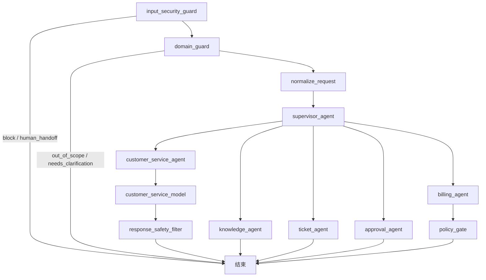

# 多智能体 LangGraph 工作流

## 1. 定位

本项目是独立的新项目，不复用现有 EduAgent、EduRAG 或其他项目的业务模块。当前工作流采用一个 Supervisor 加五个专属 Agent 的多智能体结构：客服、知识、计费、工单和审批。

## 2. 主图与专属子图

Supervisor 只负责结构化路由，不直接执行退款、建单或审批操作。客服子图当前固定经过模型结构化回复和输出安全过滤；其他专属 Agent 仍保持独立子图边界，后续可以在各自子图内部增加受白名单约束的模型调用、工具调用、重试和人工介入节点。

## 3. 共享 State

`AgentState` 是主图和子图共享的边界，包含：

- `request_id`、`tenant_scope`：请求身份和租户隔离范围；
- `conversation`、`customer_id`：对话上下文和客户标识；
- `knowledge_evidence`：客户咨询前按当前租户检索到的知识证据摘要；
- `guard_decision`、`domain_decision`：输入安全和业务范围的结构化决策；
- `supervisor_decision`、`next_action`：路由决策；
- `specialist_result`：专属 Agent 的结构化结果；
- `response_draft`、`final_response`、`response_review`：客服模型草稿、对外安全回复和过滤决定；
- `model_usage`、`model_error`、调用次数及 token 累计：模型调用的最小可审计统计；回复草稿只在本次图运行状态中传递，不写入持久化日志或审计错误，Key、完整 Prompt 和供应商原文均不落盘；
- `errors`、`trace_id`、`audit_event_ids`：错误、链路和审计关联信息。

状态只在图内传递。数据库读写必须通过租户作用域 Repository 和 Unit of Work 完成，Agent 不应直接拼接 SQL 或跨租户查询。

## 4 Guard 前置边界

主图入口先执行确定性的 `InputSecurityGuard` 和 `DomainGuard`。前者按长度、Prompt Injection、凭据/支付信息和危险动作规则产生 `allow`、`block` 或 `human_handoff`；后者按账务、账户、技术、SLA、工单、知识和客服域产生 `in_scope`、`out_of_scope` 或 `needs_clarification`。

Guard 终止时不进入 Supervisor、专属 Agent 或业务工具。退款应用服务还会再次检查安全和业务域结果：只有安全通过且业务域为 `billing`，才允许读取 Payment、记录 `billing.preview` 和创建退款申请。终止结果会写入同一租户的 AuditLog、RuntimeTrace 和 WorkflowCheckpoint，检查点中的会话内容使用脱敏占位符。

当前 Guard 是可审计的本地规则实现，不接入 LLM 分类器、Redis、正式 JWT/OAuth 或外部支付网关；模型调用和工具扩展必须继续位于这些边界之后。

## 5. 路由和工具白名单

当前 Supervisor 支持以下路由：`route_customer`、`route_knowledge`、`route_billing`、`route_ticket`、`route_approval`、`ask_clarification`、`human_handoff` 和 `finish`。

工具按 Agent 白名单注册：

| Agent | 允许工具 |
| --- | --- |
| customer_service | 无 |
| knowledge | `knowledge.search` |
| billing | `billing.preview`、`billing.execute` |
| ticket | `ticket.create`、`ticket.update` |
| approval | `approval.request`、`approval.status` |

计费工具先预览，再申请退款。退款申请必须携带租户作用域和退款幂等键；高风险申请先落库为 `Refund(REQUESTED)` 与 `ApprovalRequest(PENDING)`，再进入人工审批。未知的第三方执行状态必须进入对账或人工处理，不能自动重试造成重复退款。

## 6. 审批、Checkpoint 和降级

高风险退款经过 `policy_gate` 后进入 `human_handoff`，运行时保存 `thread_id`、原始退款幂等键、State、状态和审计关联信息。审批恢复时按租户读取 `ApprovalRequest` 和数据库 Checkpoint，只允许 `PENDING` 审批转为 `APPROVED` 或 `REJECTED`，并复用原幂等键，不重新生成业务幂等键。批准或拒绝都会写入 `ApprovalAction`、`AuditLog` 和新的 Checkpoint 状态。

`WorkflowError` 将异常转换为结构化错误；DeepSeek 网关只对配置允许的超时、传输异常和 HTTP 5xx 做有限重试，默认最多重试一次，业务工作流不因模型错误重试退款操作。未知工具状态和超过重试次数统一转人工处理。错误摘要只保存截断后的可审计信息，不保存完整敏感请求。

## 6.1 应用级 Model Gateway Factory 与客户咨询 API

应用运行时通过 `backend/llm/factory.py` 的 `create_model_gateway()` 创建网关：

- 未显式配置 `DEEPSEEK_API_KEY` 时返回 `FakeModelGateway`，本地启动和自动测试不读取真实 Key、不创建外网连接；
- 显式配置 `DEEPSEEK_API_KEY` 时才返回 `DeepSeekGateway`；
- FastAPI `create_app(model_gateway=...)` 把网关放入 `app.state`，客户咨询路由通过依赖读取同一个应用级实例。

客户咨询入口为 `POST /api/v1/customer-consultations`，要求开发环境 Header 和 `customer.consult` 权限；`POST /api/v1/customer-consultations/stream` 使用 SSE 推送 `started`、`evidence`、`completed` 和 `done` 事件。应用服务先通过 `ConsultationKnowledgeRetriever` 检索当前租户知识证据，把证据摘要注入客服模型 Prompt，再调用主图；响应返回 `final_response`、`next_action`、`response_review` 和 `knowledge_evidence_count` 摘要。输入安全 `block` 与业务范围 `out_of_scope` 映射为 HTTP 422，模型异常和敏感输出统一转人工并映射为 HTTP 202。审计日志和运行时追踪只保存 `thread_id`、状态、证据数量、安全审查代码和模型统计摘要，不保存用户原始消息、知识原文、最终回复、Key、完整 Prompt、思维链或供应商响应。SSE 不推送模型 Token、思维链、系统 Prompt、Key 或知识原文。

## 6.2 工单工具与租户事务

工单写入不直接发生在 LangGraph 节点内。`TicketTool` 只通过 `SupportRepository` 调用租户作用域的工单创建和状态转换；`TicketWorkflowService` 先运行主图 Guard 和路由，再在同一 Unit of Work 内执行 `ticket.create`、写 `TicketEvent`、`TicketMessage`、`AuditLog`、`RuntimeTrace` 和 `ToolExecution`。

工单状态转换必须通过 `transition_ticket` 状态机。Guard 未通过、业务域不是 `ticket`、跨租户客户或非法状态跳转时都不会创建或更新工单。模型和客服结构化回复不能直接触发工单写入。

## 6.3 知识检索工具与租户边界

`KnowledgeRepository` 只查询当前租户 `status="active"` 的 `documents` 记录；未配置 Milvus 时匹配标题、外部文档 ID 和来源 URI，配置后由 `MilvusKnowledgeVectorStore` 执行租户过滤的向量召回，并与 PostgreSQL 关键词结果做 RRF 融合。`KnowledgeTool` 和 `ConsultationKnowledgeRetriever` 返回安全的文档摘要，不返回文档正文或原始检索上下文。`KnowledgeWorkflowService` 先运行主图 Guard，确认业务域为 `knowledge` 后再执行检索，并写入 `AuditLog`、`RuntimeTrace` 和 `ToolExecution`。

当前知识检索已包含 PostgreSQL 确定性降级、Milvus 向量召回、RRF 混合融合、可配置 Reranker、知识摄取和客服证据注入；默认 Embedding 和精排是确定性离线实现，BGE-M3 和 Cross-Encoder 分别通过 `BGE_M3_MODEL_PATH`、`RERANKER_MODEL_PATH` 可选启用。检索日志不保存原始查询词，只保存结果数量和文档 ID 摘要。

HTTP 合同已接入 `POST /api/v1/tickets` 和 `GET /api/v1/knowledge/search`；路由仍复用对应应用服务，不直接让模型执行工单写入或知识检索。

## 6.4 本地 JWT 认证边界

`POST /api/v1/auth/tokens` 校验租户内活动用户后签发 HS256 签名 Token，业务接口优先读取 `Authorization: Bearer <token>`，未传 Token 时保留开发 Header 降级。Token 只包含租户、用户、角色类型、签发时间和过期时间，不包含密钥或敏感数据；未配置 `JWT_SECRET` 时 Token 接口返回 503，业务接口仍可继续使用本地 Header。该边界不等同于真实 OAuth、SSO 或生产身份提供商。

## 6.5 本地前端控制台

FastAPI 静态托管 `frontend/`，根路径提供本地演示控制台：可获取 JWT Token、检索当前租户知识文档、发送客户咨询并展示 SSE 进度事件，以及查看 Runtime Trace、成本和 Agent 清单。当前是静态单页控制台，不包含完整 Customer Portal、Support Workspace 或 Admin Console，也不是生产级 Next.js 前端。

## 6.6 检索评测系统

`EvaluationRunner` 读取当前租户 `evaluation_datasets` 和 `evaluation_cases`，对每个用例调用 `ConsultationKnowledgeRetriever`，计算 `Recall@K`、`Precision@K`、`MRR` 和 `NDCG@K`。单用例结果写入 `evaluation_results`，运行汇总写入 `evaluation_runs.metrics`；`POST /api/v1/evaluations/run` 执行评测，`GET /api/v1/evaluations` 查看历史。当前评测覆盖检索链路，分类、决策、工具和回复评测仍未实现。

## 6.7 长期记忆写入闭环

客户咨询完成后，`MemoryService` 在同一 Unit of Work 中从用户消息提取稳定的偏好候选，例如语言、时区和显式偏好；`MemoryWritePolicy` 拒绝低置信度、瞬时状态、凭据和敏感内容。候选写入 `memory_records`，只保存脱敏摘要和哈希，不保存原始聊天内容、最终回复或系统 Prompt。响应中的 `memory_candidate_count` 只报告候选数量。

## 6.8 模型路由、Prompt Registry 与上下文预算

`ModelRouter` 按任务解析模型路由，`PromptRegistry` 提供版本化 Prompt 模板，`ContextBudget` 在客服模型调用前限制系统 Prompt 和知识证据字符量。当前路由元数据会写入客户咨询审计，Prompt 和预算作用于客服子图；完整 Model Router 调用、Prompt 管理 API 和 DB 持久化 Prompt 版本仍属于后续阶段。

## 6.9 Runtime 可观测 API

Runtime API 基于 `runtime_traces`、`runtime_spans` 和 `agent_definitions` 提供 Trace 列表、Trace 详情、Span 摘要、Token/成本汇总和 Agent 清单。当前返回数据库已持久化的脱敏摘要，不包含原始 Prompt、知识原文或敏感业务数据；Prometheus/Grafana/OpenTelemetry 仍属于后续阶段。

## 6.10 Mock 外部服务边界

`mock_services/` 提供 Billing、CRM、Monitoring 和 Notification 四个模拟外部服务。Mock Billing 支持退款预览、幂等执行和状态查询；`MockBillingClient` 提供异步 HTTP 客户端，为未来退款执行节点提供外部系统边界。当前核心退款仍以本地 PostgreSQL 状态为准，Mock 服务不代表第三方支付网关，不处理真实资金。

## 7. 当前实际版本

版本以本机 `E:\anaconda3\envs\edu_agent` 环境实际安装结果为准，当前验收记录为：

- Python 3.11.15
- LangGraph 1.0.9
- langchain-core 1.2.16
- langgraph-checkpoint 2.1.2
- langgraph-prebuilt 1.0.8
- SQLAlchemy 2.0.36
- asyncpg 0.30.0
- Pydantic 2.11.4
- Alembic 1.18.5
- HTTPX 0.28.1
- FastAPI 0.117.1
- pytest 8.3.4
- pytest-asyncio 0.24.0

依赖声明和运行文档不使用未经本机验证的版本号。重新安装或升级环境后，应重新执行版本核验和 `pip check`。

## 8. 当前边界

当前实现已经完成多 Agent 图结构、专属子图、客服结构化模型网关、输出安全过滤、工具白名单、退款策略、工单工具与租户事务服务、RAG 向量知识库、RRF 混合检索、可配置 Reranker、客服证据注入、SSE 进度事件、本地 JWT 认证、本地前端控制台、检索评测、长期记忆写入闭环、模型路由与 Prompt Registry、Runtime 可观测 API、Mock 外部服务边界、数据库退款申请、Checkpoint、审批恢复、应用级 Gateway Factory、客户咨询 API、FastAPI 退款/审批接口和统一运行时入口。当前 `run_refund_workflow`、`TicketWorkflowService` 和 `KnowledgeWorkflowService` 均通过数据库 Unit of Work 处理本地业务状态；HTTP 层支持本地 JWT Bearer Token 和开发 Header 降级，正式 OAuth/SSO 尚未接入。生产级 Next.js 前端、外部支付适配器仍未接入，因此“退款申请已持久化”不等于“第三方退款已完成”。BGE-M3 默认加载、稀疏向量召回、真实 Cross-Encoder 模型验证、完整 Runtime Dashboard 和真实模型 API 冒烟调用不属于本阶段自动验收范围。
