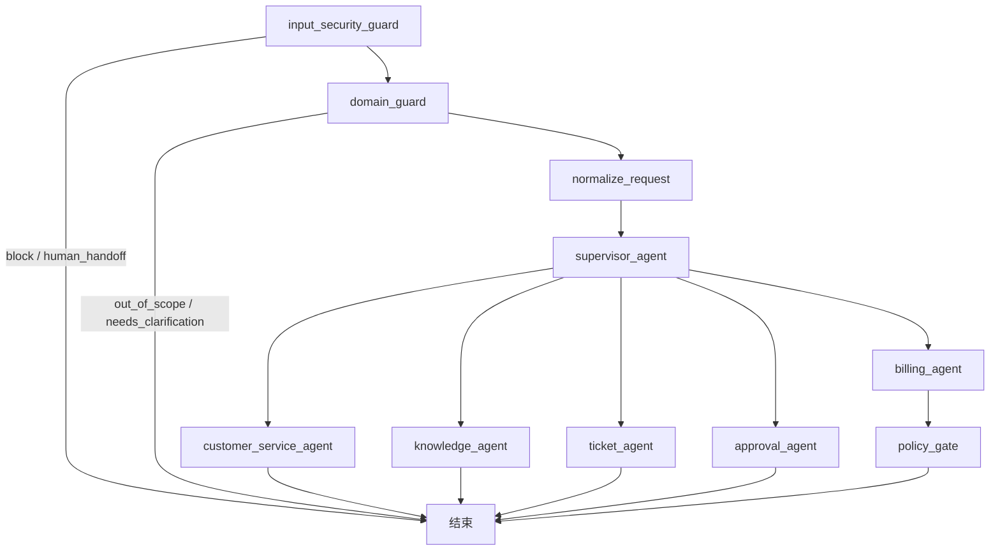

# 多智能体 LangGraph 工作流

## 1. 定位

本项目是独立的新项目，不复用现有 EduAgent、EduRAG 或其他项目的业务模块。当前工作流采用一个 Supervisor 加五个专属 Agent 的多智能体结构：客服、知识、计费、工单和审批。

## 2. 主图与专属子图

Supervisor 只负责结构化路由，不直接执行退款、建单或审批操作。每个专属 Agent 都是独立的 LangGraph 子图，后续可以在子图内部增加模型调用、工具调用、重试和人工介入节点。

## 3. 共享 State

`AgentState` 是主图和子图共享的边界，包含：

- `request_id`、`tenant_scope`：请求身份和租户隔离范围；
- `conversation`、`customer_id`：对话上下文和客户标识；
- `guard_decision`、`domain_decision`：输入安全和业务范围的结构化决策；
- `supervisor_decision`、`next_action`：路由决策；
- `specialist_result`：专属 Agent 的结构化结果；
- `errors`、`trace_id`、`audit_event_ids`：错误、链路和审计关联信息。

状态只在图内传递。数据库读写必须通过租户作用域 Repository 和 Unit of Work 完成，Agent 不应直接拼接 SQL 或跨租户查询。

## 4 Guard 前置边界

主图入口先执行确定性的 `InputSecurityGuard` 和 `DomainGuard`。前者按长度、Prompt Injection、凭据/支付信息和危险动作规则产生 `allow`、`block` 或 `human_handoff`；后者按账务、账户、技术、SLA、工单、知识和客服域产生 `in_scope`、`out_of_scope` 或 `needs_clarification`。

Guard 终止时不进入 Supervisor、专属 Agent 或业务工具。退款应用服务还会再次检查安全和业务域结果：只有安全通过且业务域为 `billing`，才允许读取 Payment、记录 `billing.preview` 和创建退款申请。终止结果会写入同一租户的 AuditLog、RuntimeTrace 和 WorkflowCheckpoint，检查点中的会话内容使用脱敏占位符。

当前 Guard 是可审计的本地规则实现，不接入 LLM 分类器、Redis、正式 JWT/OAuth 或外部支付网关；模型调用和工具扩展必须继续位于这些边界之后。

## 5. 路由和工具白名单

当前 Supervisor 支持以下路由：`route_customer`、`route_knowledge`、`route_billing`、`route_ticket`、`route_approval`、`ask_clarification`、`human_handoff` 和 `finish`。

工具按 Agent 白名单注册：

| Agent | 允许工具 |
| --- | --- |
| customer_service | 无 |
| knowledge | `knowledge.search` |
| billing | `billing.preview`、`billing.execute` |
| ticket | `ticket.create`、`ticket.update` |
| approval | `approval.request`、`approval.status` |

计费工具先预览，再申请退款。退款申请必须携带租户作用域和退款幂等键；高风险申请先落库为 `Refund(REQUESTED)` 与 `ApprovalRequest(PENDING)`，再进入人工审批。未知的第三方执行状态必须进入对账或人工处理，不能自动重试造成重复退款。

## 6. 审批、Checkpoint 和降级

高风险退款经过 `policy_gate` 后进入 `human_handoff`，运行时保存 `thread_id`、原始退款幂等键、State、状态和审计关联信息。审批恢复时按租户读取 `ApprovalRequest` 和数据库 Checkpoint，只允许 `PENDING` 审批转为 `APPROVED` 或 `REJECTED`，并复用原幂等键，不重新生成业务幂等键。批准或拒绝都会写入 `ApprovalAction`、`AuditLog` 和新的 Checkpoint 状态。

`WorkflowError` 将异常转换为结构化错误；模型超时和连接异常在最多三次尝试内允许重试，未知工具状态和超过重试次数统一转人工处理。错误摘要只保存截断后的可审计信息，不保存完整敏感请求。

## 7. 当前实际版本

版本以本机 `E:\anaconda3\envs\edu_agent` 环境实际安装结果为准，当前验收记录为：

- Python 3.11.15
- LangGraph 1.0.9
- langchain-core 1.2.16
- langgraph-checkpoint 2.1.2
- langgraph-prebuilt 1.0.8
- SQLAlchemy 2.0.36
- asyncpg 0.30.0
- Pydantic 2.11.4
- Alembic 1.18.5

依赖声明和运行文档不使用未经本机验证的版本号。重新安装或升级环境后，应重新执行版本核验和 `pip check`。

## 8. 当前边界

当前实现已经完成多 Agent 图结构、专属子图、工具白名单、退款策略、数据库退款申请、Checkpoint、审批恢复、FastAPI 退款/审批接口和统一运行时入口。当前 `run_refund_workflow` 已通过数据库 Unit of Work 写入本地业务状态；HTTP 层使用开发环境租户 Header，正式 JWT/OAuth 尚未接入。外部支付适配器仍未接入，因此“退款申请已持久化”不等于“第三方退款已完成”。
