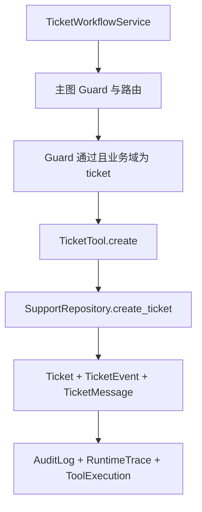

# 工单工具与租户事务边界

## 1. 定位

本阶段在现有工单领域模型、Repository 和 Unit of Work 上补充确定性 `ticket.create` / `ticket.update` 工具，以及一个工单应用服务。工单写入不能由模型直接触发，必须经过主图 Guard 和租户事务边界。

## 2. 调用链

`TicketWorkflowService` 在同一个 Unit of Work 中创建 `RuntimeTrace`、运行主图、执行工单工具并写入审计。任意一步失败会整体回滚。

## 3. Repository 边界

`SupportRepository` 新增行为：

- `create_ticket` 支持 `description_summary`、`category` 和 `initial_message`，并记录 `ticket_created` 事件；
- `update_ticket_status` 只允许通过 `transition_ticket` 的合法状态转换，并记录 `status_changed` 事件和内部消息；
- 所有查询和写入都使用 `TenantScope`，跨租户访问返回领域错误；
- 事件 payload 通过现有敏感字段脱敏逻辑落库。

## 4. 安全约束

- 工单工具不能读取或写入其他租户的数据；
- 模型、客服回复和 Superivisor 决策不能直接执行 `ticket.create` / `ticket.update`；
- 审计和运行时记录不保存完整工单正文、用户原始消息、完整 Prompt、思维链、供应商响应或 Key；
- 工单状态只能按领域状态机转换，禁止任意字符串更新。

## 5. 当前边界

当前工单应用服务已支持创建工单和状态转换工具。尚未接入工单查询 API、SSE、正式 JWT/OAuth、知识库 RAG 或第三方支付。
