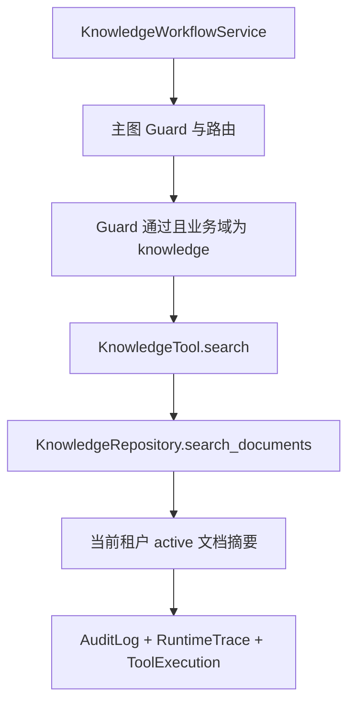

# 知识检索工具与租户边界

## 1. 定位

本阶段为知识 Agent 增加可审计的 `knowledge.search` 应用服务，使用现有 PostgreSQL `documents` 表做确定性检索，不引入 Milvus、RAG、Embedding 或外部知识服务。

## 2. 调用链

## 3. Repository 边界

- 只查询 `TenantScope` 当前租户；
- 只返回 `status="active"` 的文档；
- 匹配字段：`title`、`external_document_id`、`source_uri`；
- 返回安全摘要：文档 ID、标题、外部文档 ID、来源 URI、状态和可见性；
- 不返回文档正文、内容哈希、Prompt 或原始查询上下文。

## 4. 安全约束

- 跨租户检索返回空结果；
- Guard 未通过时不执行检索；
- 日志和审计只保存 `thread_id`、结果数量和文档 ID 摘要，不保存原始查询词；
- 模型不能直接执行 `knowledge.search`，只能通过应用服务在 Guard 之后调用。

## 5. 当前边界

本阶段不是 RAG/Milvus。尚未接入向量召回、Embedding、SSE、正式 JWT/OAuth 或第三方支付。
