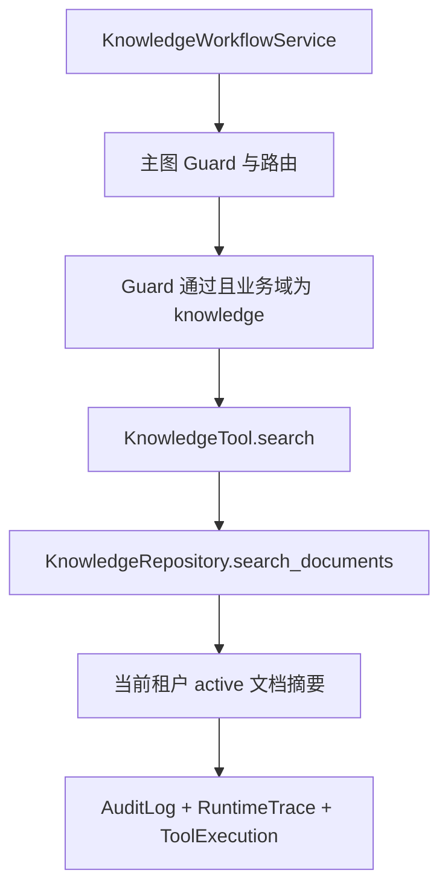

# 知识检索工具、RAG 向量库与租户边界

## 1. 定位

本阶段为知识 Agent 增加可审计的 `knowledge.search` 和 `knowledge.ingest` 应用服务：文档先分片写入 PostgreSQL `knowledge_chunks`，再同步到 Milvus 向量集合；配置 Milvus 时使用向量召回与 PostgreSQL 关键词检索的 RRF 混合结果，未配置时回退到 PostgreSQL 确定性标题检索。

## 2. 调用链

## 3. Repository 边界

- 只查询 `TenantScope` 当前租户；
- 只返回 `status="active"` 的文档；
- 匹配字段：`title`、`external_document_id`、`source_uri`；
- 返回安全摘要：文档 ID、标题、外部文档 ID、来源 URI、状态和可见性；
- 不返回文档正文、内容哈希、Prompt 或原始查询上下文。

## 4. 安全约束

- 跨租户检索返回空结果；
- Guard 未通过时不执行检索；
- 日志和审计只保存 `thread_id`、结果数量和文档 ID 摘要，不保存原始查询词；
- 模型不能直接执行 `knowledge.search`，只能通过应用服务在 Guard 之后调用。

## 5. 当前边界

本阶段已接入 Milvus 向量召回、PostgreSQL 关键词检索、RRF 混合融合和可配置 Reranker；默认使用确定性离线向量与 RRF 排序，BGE-M3 和 Cross-Encoder 分别通过 `BGE_M3_MODEL_PATH`、`RERANKER_MODEL_PATH` 可选启用。尚未接入 BGE-M3 稀疏向量召回、正式 JWT/OAuth 或第三方支付；SSE 已在客户咨询 API 提供进度事件。
