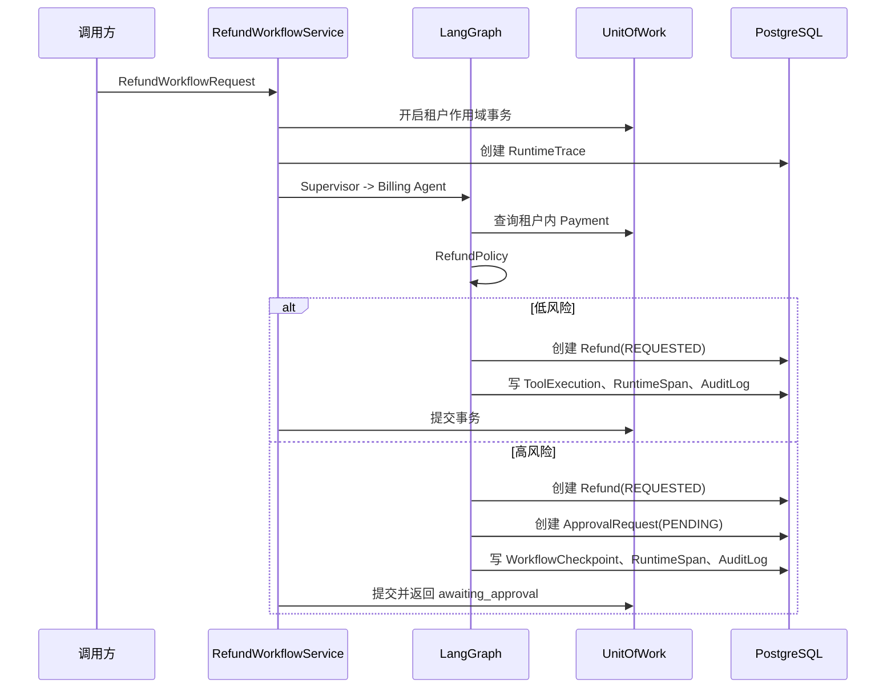

# 数据库驱动退款审批闭环设计

## 1. 背景与目标

当前项目已经具备 Supervisor + 五个专属 Agent 的 LangGraph 主图、租户作用域 Repository、退款幂等模型、策略门、内存 Checkpoint 和审批恢复接口，但 `run_refund_workflow` 尚未真正创建数据库 Unit of Work，也没有把运行追踪、审批动作和退款申请写入 PostgreSQL。

本阶段目标是完成数据库内的真实退款审批闭环：

1. 退款请求通过租户作用域 `UnitOfWork` 读取支付记录。
2. 低风险退款创建退款申请，高风险退款创建持久化审批请求。
3. 审批请求可以被批准或拒绝，批准后复用原退款幂等键。
4. 运行追踪、节点摘要、Checkpoint 和审计日志进入 PostgreSQL。
5. 跨租户支付不可见，未知执行状态不得自动重试。

本阶段不接入真实第三方支付网关，不把“创建退款申请”描述成“已完成退款”。

## 2. 方案选择

采用在现有 `approval_requests` 表增加可选 `refund_id` 的方案。

现有审批表已经服务工单审批，但 `ticket_id` 当前为必填且存在租户复合外键。直接复用会迫使退款审批伪造工单；完全改成 `resource_type/resource_id` 又会失去数据库外键约束。因此本阶段将 `ticket_id` 改为可空，增加 `refund_id` 及其租户复合外键，并增加“工单或退款至少存在一个”的检查约束。

这样既保留原有工单审批，又让退款审批能够被数据库明确约束到当前租户的 `refunds` 记录。

## 3. 数据流

审批恢复时重新读取持久化 Checkpoint 和审批请求，校验租户与审批状态；批准后只允许使用原始 `idempotency_key` 创建或读取同一条退款申请。

### 3.1 Checkpoint 表

新增 `workflow_checkpoints` 表，使用租户和 `thread_id` 唯一约束保存：`state_summary`、`refund_idempotency_key`、`status`、`trace_id`、创建时间和更新时间。`state_summary` 只保存恢复工作流所需的结构化 State，不保存完整敏感对话；请求原文只保留脱敏摘要和哈希。

## 4. 代码边界

### 4.1 工作流请求

新增退款业务请求模型，至少包含：`thread_id`、`state`、`payment_id`、`amount` 和 `idempotency_key`。通用 `WorkflowRequest` 仍保留给非退款 Agent 流程，退款入口不把金额和支付 ID 塞进自然语言消息。

### 4.2 应用服务

新增 `RefundWorkflowService`，负责：

- 创建和结束 `RuntimeTrace`；
- 为每个主要节点保存脱敏的 `RuntimeSpan`；
- 调用 `BillingTool.preview` 和 `BillingTool.execute`；
- 根据 `PolicyDecision` 创建退款申请或审批请求；
- 将异常转化为 `WorkflowError` 并在事务失败时回滚。

LangGraph 只负责路由和 Agent 协作，不直接创建数据库 Session。数据库事务由应用服务和 `UnitOfWork` 统一控制。

### 4.3 Repository

补充以下租户作用域操作：

- 创建或读取退款审批请求；
- 读取审批请求并校验其关联退款属于当前租户；
- 写入审计日志、工具执行摘要和运行追踪；
- 按幂等键读取现有退款，重复请求返回原记录。

所有写入都使用 `TenantScope` 的 `tenant_id` 和 `actor_id`，不允许从消息文本推断租户。

## 5. 事务与错误策略

- 支付查询、退款申请、审批请求、工具执行摘要和审计日志在同一个 Unit of Work 中提交。
- 任一确定性校验失败，整个事务回滚。
- 外部支付执行尚未接入，因此本阶段不实现“外部调用成功但本地提交失败”的补偿逻辑。
- 已存在 `UNKNOWN_EXECUTION_STATE` 的退款禁止自动重试，必须转人工对账。
- 数据库唯一约束负责兜底租户内幂等键重复；应用层先查，数据库层再兜底。
- 错误只保存错误码、节点名和截断摘要，不保存完整请求、令牌或敏感支付信息。

## 6. 测试验收

测试先写失败测试，再实现：

- 退款审批请求可以关联 `refund_id`，工单审批仍可用。
- 跨租户 `payment_id` 查询返回“不可见”，不会创建退款。
- 低风险退款创建一条 `REQUESTED` 退款并写入审计记录。
- 高风险退款创建一条审批请求，状态为 `PENDING`。
- 审批批准后复用原幂等键，重复执行不会产生第二条退款。
- 拒绝审批不会执行退款。
- 未知执行状态不触发自动重试。
- 运行追踪、节点摘要和工具执行记录都带有正确租户和 trace 关联。
- 数据库 Checkpoint 能在进程重启后按租户和 `thread_id` 恢复。
- 全量测试、`pip check`、`compileall`、`alembic check` 和数据库结构验收通过。

## 7. 明确不包含的内容

- 不接入外部支付平台 SDK。
- 不在本阶段引入新的 Agent。
- 不把当前的关键词 Supervisor 宣称为生产级模型决策器。
- 不修改现有项目或 EduAgent、EduRAG 代码。
