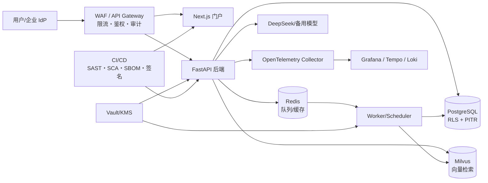
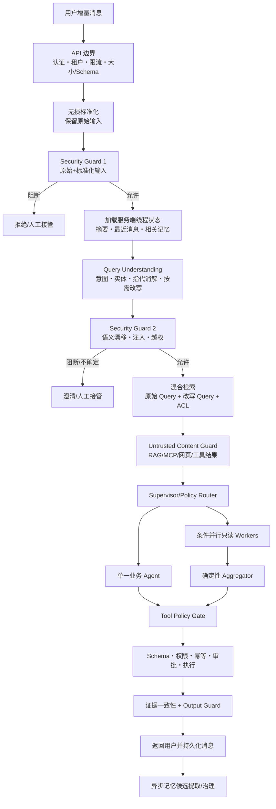

# CloudDesk 企业级改造路线图

> 已提交代码基线：`main @ 9368e8a`。
> 企业级基线分支：`chore/enterprise-baseline`（基于 `9368e8a`，含 3 个可审查提交；tag `enterprise-baseline-2026-10-23`）。
> 评估时间：2026-10-23（初版 2026-10-22）。
> 目标：保留现有“咨询 → 工具调用 → 审批 → 审计”的业务闭环，把身份、隔离、可靠性、可观测、交付与合规补齐到企业级；数据可以脱敏，但工程标准不降级。

### 证据口径

- **已实现**：可在当前代码中定位实现与测试，但不等于已完成生产验收。
- **已验证基线**：`9368e8a` 的历史记录为 `328 passed`，并完成迁移 `001 -> 009`、`alembic check` 与 `pip check`。
- **企业级基线分支**：2026-10-23 启动 PostgreSQL `54330`、Milvus `19541`、Redis `16380` 后在 `chore/enterprise-baseline` 实测 **333 passed**（约 114 秒），`alembic current` 为 `009 (head)`，`verify_database.py` 通过，`alembic check` 无漂移；从 tag `enterprise-baseline-2026-10-23` 创建干净 checkout 后再次复现 **333 passed**。仍不能等同于生产验收：`.venv` 为 Python 3.11.0（项目声明 3.11.15），且 CI 尚未执行。
- **目标能力**：路线图计划建设，完成后仍需自动化测试、运行证据和演练报告证明。

---

## 1. 结论先行

当前项目是一个**可演示、业务闭环基本成立的垂直切片**，还不是企业级平台。差距不在“功能数量”，而在这六件事：

1. **身份与权限**：仍是本地 JWT + 开发 Header，没有 OAuth/SSO、MFA、SCIM、会话吊销。
2. **租户隔离**：只靠应用层 Repository 过滤 + 复合外键，没有 PostgreSQL RLS 兜底。
3. **可靠性**：已有基础 Redis Broker、Worker 与 Scheduler，但没有 Outbox、可靠投递、统一幂等、限流/配额、HA/DR 和容量验证。
4. **可观测**：有 Trace/Audit，但没有 OpenTelemetry、结构化日志、日志聚合、告警和 SLO。
5. **交付与供应链**：CI 已覆盖前端 lint/build、数据库迁移、后端测试、迁移漂移、依赖检查和镜像构建，但没有 SAST、依赖漏洞门禁、镜像扫描、SBOM、签名、E2E、灰度与回滚。
6. **Agent 平台化**：已有 Pydantic ActionDecision、ToolContract、基础 ToolRegistry 和代码内 PromptRegistry，但工具调度仍是硬编码 action；长期记忆只写不读；会话虽已落库，咨询入口仍依赖客户端回传 history。

建议顺序：**Pre-Sprint 0 先恢复可复现基线（3~5 个工作日）→ P0 补“企业门槛”（8 周）→ P1 补“生产可靠性与 Agent 平台”（12 周）→ P2 做首轮压测、灾备与合规评估（4 周，之后持续）**。
主计划共 12 个 Sprint、每个 Sprint 2 周，即 **24 周**；加上 Pre-Sprint 0 约 **25 周**。按 3~4 人具备后端、前端、DevOps/安全能力的小团队估算。单人开发请按范围重新排期，不能简单承诺同样的退出标准。

---

## 2. 现状评估

| 维度 | 当前实现 | 企业级差距 | 优先级 |
| --- | --- | --- | --- |
| 身份认证 | 本地 JWT 签发；开发 Header `X-Tenant-Id`/`X-Actor-Id` 可降级 | 无 OIDC/SAML SSO、MFA、SCIM、JWKS 轮换、会话吊销、服务账号/API Key | P0 |
| 权限模型 | `require_permission` + Role/Permission 表；已有部分 API 权限与跨租户测试 | 无统一策略引擎（RBAC/ABAC）、无全路由权限矩阵、无前端权限门禁、无敏感操作二次确认 | P0 |
| 租户隔离 | `TenantScope` + Repository 过滤 + 复合外键；已有退款等跨租户测试 | 无 PostgreSQL RLS；测试未覆盖全部表、导出和后台任务；无租户生命周期/配额 | P0 |
| 数据治理 | 输入/输出正则脱敏；审计摘要+哈希 | 无 PII 分类分级、保留期、DSAR 导出/删除、字段级加密、备份加密 | P0 |
| Agent 编排 | LangGraph 固定图：输入 Guard → 领域 Guard → 检索 → Supervisor → 单一业务分支 → 客服输出 | 当前是受控串行单分支，不是并行协作 Agent；ToolRegistry 尚未参与统一调度；缺少条件并行、聚合器和统一策略引擎 | P1 |
| 上下文/多轮 | 客户端回传 history + 当前消息 + RAG 证据；服务端已持久化会话 | 咨询入口不按 `tenant_id + user_id + thread_id` 自动回灌权威历史；客户端历史可被篡改；无 Token 预算、滚动摘要和并发版本控制 | P1 |
| 长期记忆 | 已有候选提取、写入策略、TTL 和定期过期清理 | 当前只写不读；无相关性检索、冲突/纠错、用户查看/删除/关闭、记忆投毒防护 | P1 |
| Guard/安全 | 最新用户消息执行规则型 InputSecurityGuard；完整对话执行 DomainGuard；回答后执行输出安全过滤 | 主要依赖 NFKC + 静态关键词/正则；未单独检查 Query Rewrite、RAG 文档、网页/MCP/工具结果中的间接提示词注入 | P0/P1 |
| Query 理解 | Supervisor 有意图路由，检索 Query 基本仅 `strip()` 后直接使用 | 无指代消解、实体提取、独立 Query Rewrite/Decompose；没有保留“原始 Query + 改写 Query”联合召回和语义漂移检查 | P1 |
| 工具调用 | Pydantic ActionDecision/ToolContract + 6 个 action；已有模型/工具重试、Milvus timeout、退款幂等 | ToolRegistry 主要是元数据；缺少运行时统一输入/输出校验、全写接口幂等、熔断和策略审计 | P1 |
| 审批 | 退款审批 + PostgreSQL Checkpoint + 审计 + 恢复测试 | 只覆盖退款；无审批 SLA、升级、委派、职责分离、批量审批和通用 HITL | P1 |
| RAG | Milvus + PG + RRF + 可选 reranker；已有租户过滤和离线评测能力 | 默认离线 Embedding；评测未成为 CI 门禁；visibility 未形成角色级强制过滤；无 Query Rewrite、间接注入检测和引用溯源 UI | P1 |
| 可靠性 | 单后端实例；已有 Redis Broker/Worker/Scheduler，当前仅处理记忆过期 | 无 Outbox、ACK/重试/DLQ、全局幂等中间件、限流/配额、HA/DR、灰度 | P0/P1 |
| 可观测 | Runtime Trace、Audit、/metrics | 无 OpenTelemetry、无日志聚合、无告警、无 SLO/错误预算；成本未计价 | P0 |
| 测试 | 历史基线 328 条；当前工作区 2026-10-23 实测 333 passed | 无浏览器 E2E 门禁、无外部供应商消费者驱动契约、无压测、无混沌/故障注入 | P0/P1 |
| CI/CD | 前端 lint/build、迁移、后端测试、`alembic check`、`pip check`、镜像构建 | 无 SAST/SCA/密钥扫描/镜像扫描/SBOM/签名；无 staging→prod 推广 | P0 |
| 部署 | Docker Compose + 基础 K8s YAML | 无 Helm/Kustomize、HPA/PDB/NetworkPolicy、备份恢复、灾备演练 | P1 |
| 前端 | Next.js 三门户 + 身份选择器 | 无 SSO 登录、RBAC 菜单、错误监控、可访问性/i18n 门禁、E2E | P1 |

### 2.1 本地单机约束与取舍

当前开发机是个人电脑，Docker Desktop 约 4GB 内存/4 CPU，且可能同时运行其他项目的容器。企业级能力不能靠“堆机器”，本地按以下约束落地：

- **IdP**：本地优先 **Dex**（轻量、标准 OIDC、单容器），需要完整管理界面时再换 Keycloak；后端只依赖标准 OIDC issuer/JWKS，生产可无缝换 Entra ID / Auth0。
- **运行时**：PostgreSQL、Milvus、Redis、IdP 跑 Docker，后端/前端本机进程；本地不跑 Kubernetes、多区域、完整 Prometheus/Grafana 栈。
- **资源**：Keycloak 若启用需限制 JVM 堆（如 `-Xmx512m`）；监控/压测用 compose profile 按需启动。
- **密钥**：本地 `.env` 仅限开发；生产必须 Vault/KMS/External Secrets，两者不能混用。
- **备份**：本地磁盘备份 + 恢复演练；云上 PITR、跨区复制作为部署阶段能力。
- **CI**：GitHub Actions 负责远端门禁；本地只做 pre-commit 与快速回归。
- **本地无法证明的**：多可用区、WAF、云 KMS、真实渗透测试、99.9% SLA；这些只能设计接口并在 staging/生产验收，不能写成“已完成”。

结论：**代码与流程按企业级标准建设，运行时按单机规模裁剪**；不把“本地能跑”当成“生产已验证”。

---

## 3. 目标架构



关键原则：

- **控制面与数据面分离**：身份、配额、审计在网关/中间件；业务逻辑在服务层。
- **默认拒绝**：无 token 不进入业务；无权限不进入工具；跨租户查询由 RLS 兜底。
- **一切可追踪**：每个请求有 `request_id`/`trace_id`，每次模型调用有 prompt 版本、模型、Token、成本，每次工具调用有参数摘要与结果摘要。
- **失败可恢复**：写操作幂等；异步任务 Outbox；审批可恢复；部署可回滚。

### 3.1 Agent 请求处理目标链路



顺序必须满足以下安全不变量：

1. **先 Guard，后 Query Rewrite**：不能让未经检查的原始输入先进入改写模型。
2. **改写后再次 Guard**：改写模型可能发生语义漂移、丢失关键编号或放大恶意意图。
3. **原始 Query 永不丢失**：检索、审计和评测同时保留原始与改写版本；订单号、错误码、产品编码默认走精确查询或跳过改写。
4. **所有外部内容均为不可信数据**：RAG 文档、网页、邮件、MCP/Tool 返回值不能成为系统指令，也不能直接决定工具参数。
5. **授权在执行层生效**：模型只能提出动作，Policy Gate 和 Tool Executor 依据真实用户、租户、目标资源和参数决定是否允许。

### 3.2 上下文与多轮对话

- 客户端只发送增量消息、`thread_id` 和可选 `last_turn_id/version`；前端 localStorage 只用于展示和断线恢复，不作为权威历史。
- 服务端按 `tenant_id + user_id + thread_id` 加载会话，验证线程归属和版本，防止伪造历史、跨租户续聊及并发覆盖。
- Prompt Context 固定分层：不可变系统规则 → 身份/租户/权限 → 滚动摘要 → 最近 4~8 轮 → 相关长期记忆 → RAG/工具证据 → 当前问题。
- 从字符截断升级为 Token 预算；安全规则和权限上下文不可裁剪，旧消息先摘要，证据按相关性和来源等级裁剪，并为最终回答预留输出预算。
- 摘要不是事实权威：保留摘要版本、覆盖消息区间和来源 ID；涉及金额、审批、订单号时回查原始消息或业务数据库。

建议初始预算（须按模型窗口与真实流量压测调整）：

| 上下文区域 | 建议占比 | 规则 |
| --- | ---: | --- |
| 系统/安全/权限 | 15%~20% | 固定保留，不被用户或外部内容覆盖 |
| 最近消息 + 滚动摘要 | 25%~35% | 最近消息优先；旧消息摘要化 |
| 记忆 + 检索/工具证据 | 30%~40% | 按 ACL、相关性、可信度和新鲜度选择 |
| 最终回答预算 | 15%~25% | 调用前预留，避免输出被截断 |

### 3.3 记忆分层与治理

| 记忆层 | 内容 | 存储/生命周期 | 使用方式 |
| --- | --- | --- | --- |
| Working Memory | 当前图状态、路由、工具结果、错误 | LangGraph State；单次 Run | 节点间传递，不跨线程 |
| Thread Memory | 消息、滚动摘要、未完成事项 | PostgreSQL/Checkpoint；线程级 | 多轮续聊和中断恢复 |
| Long-term Memory | 稳定偏好、语言、经授权的用户事实 | PostgreSQL 为真值，向量索引为派生；TTL | 相关性检索后少量注入 |
| Episodic Memory | 已解决工单、审批结果、任务经验 | 业务库/审计库；按保留策略 | 复盘、相似案例和恢复 |
| Procedural Knowledge | Prompt、Policy、Skill/SOP | Git/版本化 Registry | 不是用户记忆，不由模型自由改写 |

记忆读取必须先做租户/用户授权，再做相关性检索和冲突过滤；返回 `source`、`confidence`、`created_at`、`last_verified_at`、`expires_at`、`supersedes`。记忆写入采用“候选提取 → 敏感信息检查 → 稳定性判断 → 去重/冲突 → 策略/用户同意 → 持久化”，不得允许模型直接写正式记忆。密码、Token、验证码、银行卡、证件号不得进入长期记忆。用户必须能够查看、纠正、删除、导出和关闭记忆。

### 3.4 Agent 编排策略

- **默认串行**：当前客服、退款、工单、审批等交易链保留 Supervisor → 单一专家 → 客服输出，便于审计与失败恢复。
- **条件并行**：只并行执行互不依赖、只读、可独立超时/失败的工作，例如知识检索、账户状态和 SLA 查询；由确定性 Aggregator 合并。
- **写操作串行**：退款、建单、审批、通知和状态修改不得由多个 Agent 并发执行；必须经过幂等、版本校验、Policy Gate 和必要的 HITL。
- **不要为每个 API 创建 Agent**：单一原子能力建 Tool；稳定业务 SOP 建 Skill；只有具备独立目标、状态、决策边界和权限域时才建 Agent。

### 3.5 Agent / Skill / Tool / MCP 扩展模型

| 扩展对象 | 定位 | 最低定义要求 |
| --- | --- | --- |
| Agent | 独立目标和决策边界的专家 | 输入/输出 State Schema、允许的 Skill/Tool、Policy/Model/Prompt Profile、预算、超时、版本、负责人 |
| Skill | 可复用、可评测的业务 SOP | 前置条件、步骤、所需 Tool、缺参处理、HITL 点、失败回退、输出 Schema、测试样例 |
| Tool | 单一原子能力 | JSON Schema 输入/输出、副作用等级、权限、租户范围、幂等、超时/重试、限流、脱敏、审计、健康检查 |
| MCP Server | 外部系统和工具集合的标准边界 | 服务身份、认证、允许工具、租户绑定、网络出口、信任等级、Payload 上限、超时和审计 |

运行时改造成 `Manifest Registry → Schema Validator → Policy Binder → Agent/Skill/Tool Resolver → Governed Executor`。新增普通 Agent/Skill 不修改主图核心；新增真实业务能力仍需实现 Adapter、契约测试、权限策略、评测和灰度，不能把“配置驱动”误解为任意外部工具零代码可信接入。

示例 Manifest：

```yaml
id: billing_agent
version: 2.1.0
input_schema: BillingAgentInput
output_schema: BillingAgentOutput
allowed_skills: [duplicate_charge_review]
allowed_tools: [invoice.get, refund.preview]
policy_profile: billing_standard
model_profile: reasoning_medium
prompt_version: billing_prompt_v8
timeout_ms: 15000
max_tool_calls: 5
rollout: canary
```

### 3.6 主流实践依据与项目取舍

- LangGraph 将短期记忆作为线程级 State/Checkpoint，将长期记忆作为跨会话 Store，并建议长对话使用 Token 裁剪或滚动摘要：[LangGraph Memory](https://docs.langchain.com/oss/python/langgraph/add-memory)。
- LangGraph 将 Routing、Parallelization、Orchestrator-Worker 作为不同模式；并行适用于独立子任务，不代表全部 Agent 并发：[LangGraph Workflows and Agents](https://docs.langchain.com/oss/python/langgraph/workflows-agents)。
- OpenAI Agents SDK 区分 Handoff 与 Manager/Agents-as-tools，并强调输入、输出和每次工具调用的 Guard 边界：[Multi-agent Orchestration](https://openai.github.io/openai-agents-python/multi_agent/)、[Guardrails](https://openai.github.io/openai-agents-python/guardrails/)。
- Azure RAG 指南将 Query Rewrite 作为可选检索增强，建议保持原始意图并将原始/改写查询共同用于召回；精确标识符需谨慎：[Azure AI Search Query Rewrite](https://learn.microsoft.com/en-us/azure/search/semantic-how-to-query-rewrite)。
- OWASP 将直接/间接提示词注入、RAG 污染、记忆投毒、越权工具调用纳入同一威胁面，推荐最小权限、工具参数验证、输出监控和高风险 HITL：[OWASP LLM Prompt Injection Prevention](https://cheatsheetseries.owasp.org/cheatsheets/LLM_Prompt_Injection_Prevention_Cheat_Sheet.html)。
- MCP 提供工具发现和 JSON Schema 契约，但工具 Annotation 和返回内容不能因为“来自 MCP”就自动可信；高风险调用应向用户展示并允许拒绝：[MCP Tools](https://modelcontextprotocol.io/specification/2025-06-18/server/tools)。

本项目采用这些成熟模式，但不追求一次性全自治：近期优先服务端上下文、双阶段 Guard、统一 Tool Executor 和可读取记忆；并行 Worker、动态 Planner 和插件生态在评测与权限边界稳定后再逐步开放。

### 3.7 非关系型存储与中间件的租户隔离

PostgreSQL RLS 只覆盖关系库；企业级租户隔离必须把 Milvus、Redis、对象存储、日志与 Trace 一起纳入，否则会出现“数据库隔离了，向量/缓存/队列串租户”的漏洞。

| 组件 | 风险 | 最低要求 |
| --- | --- | --- |
| Milvus | 仅靠 `tenant_id` 过滤，查询条件漏写即跨租户召回 | 明确 collection/partition 策略；检索强制 tenant 过滤；跨租户召回测试；索引重建与删除传播 |
| Redis | 单队列 `ecop:tasks`，payload 无租户绑定 | key 前缀 `tenant:{id}:`；任务 payload 校验 tenant_id；按租户/优先级分队列；DLQ 可审计 |
| MinIO/对象存储 | 预签名 URL 或 bucket policy 过宽 | 租户前缀或独立 bucket；最小权限 policy；URL 短 TTL；删除传播 |
| 日志/Trace | 查询侧可跨租户检索 | 强制 tenant 标签；查询鉴权；导出审批；敏感字段脱敏 |
| 缓存 | 仅按用户输入做 key，可能命中他人结果 | key 必须包含 tenant/user/权限上下文；TTL；删除/失效传播 |

**验收**：跨租户向量召回、缓存命中、队列消费、对象下载、日志查询均有自动化攻击测试；任一组件缺失 tenant 上下文时必须 fail-closed。

### 3.8 模型供应商与数据治理

对金融客户，“模型在哪里、数据留多久、是否用于训练”与功能同样重要。必须建立供应商登记与数据流图：

- DPA/数据处理协议、是否用于训练、Prompt/响应保留期、删除机制；
- 数据驻留与跨境：DeepSeek API 的调用链、代理/网关、日志落点；
- 子处理者清单、模型变更通知、供应商退出与迁移方案；
- 备用模型必须满足同等数据条款，不能只验证可用性；
- 敏感行业可要求“不落地/不留存/私有化部署”，需提前设计开关与成本。

**验收**：每个模型供应商有登记表、DPA、数据流图、保留/删除说明；切换供应商不改变租户数据边界。

---

## 4. 路线图

### P0：企业级门槛（Sprint 1~4，约 8 周）

目标：通过企业安全/运维尽调，能上 staging 并接待真实试点租户。

#### P0-0 可复现基线（Pre-Sprint 0，3~5 个工作日）

- 已完成：演示修复拆成 3 个可审查提交（`ecfde82`、`c179444`、`5c09425`）；未跟踪资产未纳入，`交接文档.md`、`.env` 未提交。
- 将开发/CI Python 统一到项目声明的 3.11.15（当前 `.venv` 为 3.11.0），并在干净环境复现 333 passed。
- 在隔离数据库上重跑迁移、完整后端测试、前端 lint/build 和容器构建，记录命令、环境和结果。
- 测试隔离：`tests/unit/database` 已从 `drop_all` 公共 schema 改为每次 session 创建临时 schema，并要求显式 `TEST_DATABASE_URL`；CI 已同步该变量。后续所有数据库测试必须使用独立库或独立 schema，禁止触碰开发库。
- 给基线打可追溯 tag 或 release candidate；路线图后续验收都引用该 commit，不引用“本地最新代码”。
- 退出标准：干净 checkout 可一键复现 CI；未提交工作区与基线明确分离；测试与迁移全绿。

#### P0-1 身份与权限

- 接入 OIDC（本地用 Dex 或 Keycloak；生产用 Entra ID / Auth0 / Keycloak 任一），后端用 JWKS 校验，前端走标准 Authorization Code + PKCE；代码只依赖 issuer/JWKS，不绑定具体厂商。
- 已落地（2026-10-23，本地）：Dex OIDC、`AUTH_MODE=dev/jwt-only/oidc`、`/auth/oidc/config|exchange`、前端 `/login` 与 `/auth/callback`；`AUTH_MODE=oidc` 下开发 Header 与 `/auth/tokens` 已禁用。
- 先确定权限权威来源：建议 Token 携带 `sub`、`tenant_id`、`groups/roles`、`session_id` 等稳定声明，细粒度 permissions 由服务端策略/数据库判定，避免 Token 与数据库权限漂移。
- 支持密钥轮换与会话吊销；明确采用短期 Token + refresh、denylist、IdP introspection 或事件同步中的哪一种机制。JWKS 只解决签名密钥发现，不等于会话吊销。
- `AUTH_MODE=oidc` 时彻底禁用 `X-Tenant-Id`/`X-Actor-Id` 开发 Header。
- RBAC：角色 → 权限矩阵集中定义；前后端共用一份权限清单；敏感操作（审批、删除、导出）二次确认。
- 可选：SCIM 2.0 用户/组同步；服务账号与 API Key（带 scope、过期、轮换）。
- 验收：无 token 401；越权 403；跨租户 403/404；权限矩阵测试覆盖全部路由；SSO 登录 E2E 通过。

#### P0-2 租户隔离与数据治理

- PostgreSQL RLS：先建立租户表清单，再为所有含 `tenant_id` 的业务表启用 policy；每个事务内、首次业务 SQL 前执行 `SET LOCAL app.tenant_id`；Repository 过滤仍作为第二道防线。
- RLS 必须 fail-closed：未设置或 tenant_id 非法时返回 0 行/拒绝写入；评估 `FORCE ROW LEVEL SECURITY`，避免表 owner 绕过策略。
- 为 API、Worker/Scheduler、迁移、平台运维分别设计最小权限数据库角色；测试不得使用会自动绕过 RLS 的超级用户制造“假通过”。
- 增加连接池复用测试，证明请求结束后租户上下文不会泄漏到下一连接使用者。
- 增加跨租户攻击测试：直接构造其他 tenant_id 的读写、批量导出、SQL 注入路径，全部拒绝。
- 租户生命周期：创建/停用/删除、配额（用户数、知识量、调用量）、数据导出。
- PII 分类分级：手机号/邮箱/卡号/地址/证件号识别；日志、Trace、审计、Prompt 全链路脱敏。
- 保留期与删除：先建立数据分类、法定保留和删除例外矩阵，再按租户配置 TTL；DSAR 导出/删除任务幂等且可审计。
- 删除传播矩阵：关系库 → Milvus 向量/索引 → Redis 缓存/队列 → MinIO 对象 → 日志/Trace。审计记录按 WORM/去标识化例外处理；备份中的删除依靠保留期滚动，并在 DPA 中明确说明。
- 协调“被遗忘权”与 WORM 审计：需要保留的审计记录采用最小化、去标识化或密钥销毁策略，不能同时承诺原文彻底删除和不可篡改长期保留。
- 验收：RLS 测试 100% 通过；日志抽样无明文 PII；删除任务可重放且幂等。

#### P0-3 可观测性与审计

- 接入 OpenTelemetry：FastAPI、SQLAlchemy、httpx、LangGraph 节点、工具调用统一 span；导出到 Tempo/Jaeger。
- 结构化日志（JSON）：`request_id`、`tenant_id`、`trace_id`、`route`、`latency`、`status`；禁止记录 Prompt/Key/知识原文。
- Prometheus 指标：请求量/延迟/错误率、模型调用量/Token/成本、工具成功率、审批积压、队列深度。
- Grafana 看板 + 告警：5xx、P95 延迟、模型错误率、审批超时、队列积压、DB 连接池。
- 候选 SLO：API 可用性 99.9%、非模型 P95 < 500ms、首 token P95 < 2s、错误率 < 0.5%；先完成基线测量、流量模型和成本评估，再转为正式 SLO/SLA。
- 审计不可篡改：审计日志写入 WORM 存储（S3 Object Lock / 只追加表），保留 ≥ 180 天。
- 验收：一次请求可在 Grafana 看到完整链路；告警能触发并送达；审计可导出。

#### P0-4 交付与供应链安全

- CI 增加：CodeQL/SAST、`pip-audit`、`npm audit`、Trivy 镜像扫描、Gitleaks 密钥扫描、Syft SBOM、Cosign 签名。
- 分支保护：必须通过 CI、至少 1 人 review、禁止直接 push main。
- 环境分离：dev/staging/prod 三套配置；staging 自动部署，prod 手动审批 + 灰度。
- 迁移门禁：`alembic upgrade head` + `alembic check` + 回滚脚本演练；生产迁移禁止自动 drop。
- E2E smoke：Playwright 覆盖登录、咨询、审批、Runtime；每次部署必跑。
- 验收：高危漏洞/密钥泄露会阻断合并；误报必须走有责任人、到期时间和补偿控制的例外流程；镜像有 SBOM 与签名；回滚演练成功。

#### P0-5 安全基线

- 密钥管理：Vault/AWS Secrets Manager/K8s External Secrets；禁止 `.env` 进生产；Key 轮换。
- 网关/应用：CORS 白名单、安全响应头（CSP/HSTS/X-Frame-Options）、请求体大小限制、超时、限流。
- 租户级配额：RPM/TPM、并发、知识库容量、模型预算；超限 429。
- 依赖与镜像：固定版本、月度升级窗口、CVE 响应 SLA。
- 威胁建模：Prompt Injection、越权、SSRF、数据外泄、审批绕过、模型供应链。
- 验收：OWASP Top 10 自查通过；限流/配额生效；无高危 CVE。

#### P0-6 备份与恢复

- PostgreSQL PITR（WAL 归档）；每日全量 + 持续归档；保留 30 天。
- Milvus/对象存储快照；Redis 持久化（如承载队列）。
- 恢复演练：先按试点业务分级确定候选 RPO/RTO；`RPO ≤ 5 分钟、RTO ≤ 1 小时` 作为待成本评估和演练证明的目标，而不是未经验证的合同承诺；每季度至少一次。
- 验收：从备份恢复到新环境并跑通 smoke。

#### P0-7 事件响应与客户支持

- 建立事故分级（P0~P3）、on-call 轮值、升级路径和“谁有权对外沟通”。
- 明确 Status Page、客户通知模板、SLA 违约处理与补偿口径。
- 安全事件流程：发现 → 遏制 → 根除 → 恢复 → 复盘；明确监管/客户通报时限。
- 为数据库、Milvus、模型供应商、队列、认证分别编写 Runbook，并每季度做一次桌面演练或故障注入。
- 验收：模拟一次 P1 事故，30 分钟内完成分级、通知与止损；复盘有行动项、负责人和到期时间。

---

### P1：生产可靠性与 Agent 平台（Sprint 5~10，约 12 周）

目标：支撑多租户试点、流量增长与真实运营。

#### P1-1 可靠性与弹性

- 后端多副本 + 无状态化；HPA/PDB；优雅停机。
- 在现有 Redis Broker/Worker/Scheduler 上补齐邮件/通知、知识索引、审批超时等 Handler；增加 ACK、指数退避、最大重试、DLQ、任务状态与队列指标。
- Outbox 模式保证“业务写入 + 事件记录”同事务提交，由发布器至少一次投递；消费者必须幂等并能处理重复消息。
- 幂等中间件：所有写接口支持 `Idempotency-Key`；保留现有退款幂等约束，并扩展到工单、审批和知识摄取。
- 在现有模型重试、通用 `with_retry` 和 Milvus timeout 基础上统一超时/重试策略；模型、Milvus、Billing/CRM 分别配置，重试带 jitter，并补熔断/半开与可观测指标。
- 压测：先基于试点租户数、消息大小、模型延迟和读写比例建立场景，再用 k6/Locust 逐级压测；`100 并发咨询、1000 并发查询` 只作为候选容量点，不作为无依据硬指标。
- 验收：单个无状态 API 副本退出不影响整体服务；消息不丢失、允许重复投递但不产生重复业务副作用；容量、瓶颈和恢复时间可量化。

#### P1-2 Agent 平台化

- 通用 Tool 协议：JSON Schema 定义输入/输出、副作用等级、权限、租户范围、超时/重试、幂等、限流、脱敏、审计和健康检查；ToolRegistry 真正参与运行时解析与调度。
- 建立 Agent/Skill/Tool Manifest 与版本 Registry；用动态 specialist resolver/subgraph factory 替代 Action Literal、domain allowlist 和 executor `if` 链的多处硬编码。
- 统一 Governed Tool Executor：模型只提出结构化动作，执行器重新验证真实用户意图、目标资源、参数、权限和幂等键；写操作不得由模型直接落库。
- 在现有可选知识库/Web Search MCP 基础上做生产治理：认证、租户绑定、工具 allowlist、信任等级、网络出口白名单、SSRF 防护、Payload 上限、超时、内容脱敏、间接注入检测与审计；再接内部系统。
- 策略引擎：OPA/Cedar 或代码化 policy，统一“能不能调、要不要审批、能读取哪些字段、结果是否需要脱敏”。
- HITL 通用化：不只退款；支持工单升级、批量操作、敏感知识发布；审批 SLA/升级/委派/职责分离。
- 扩展现有 PostgreSQL `DatabaseCheckpointStore`：从退款审批扩展到通用流程，补状态版本、完整重放、人工中断、兼容迁移和过期清理。
- 编排默认串行；仅对独立只读任务启用受控 fan-out/fan-in，并设置并发上限、统一 deadline、取消传播、部分失败语义和确定性 Aggregator。所有写操作保持串行。
- 验收：新增普通 Agent/Skill 不修改主图核心；新增工具仅新增业务适配器、schema、权限策略、注册配置和测试；所有工具调用有权限、幂等、超时、Guard 与审计。

#### P1-3 上下文与记忆

- 服务端会话状态：复用已经落库的 Conversation/Message，咨询入口按 `tenant_id + user_id + thread_id` 校验归属并读取历史；前端只传增量消息和可选 `last_turn_id/version`，支持多设备续聊和并发冲突检测。
- 上下文工程：按系统/安全、租户/权限、滚动摘要、最近消息、长期记忆、RAG/工具证据分层；使用 Token 预算、来源优先级、摘要压缩和引用去重，替代单纯字符截断。
- 长期记忆读取：先授权和相关性检索，再按置信度、新鲜度、冲突状态注入；PostgreSQL 保存真值，向量索引仅作派生检索。
- 长期记忆写入：成功响应或工具结果后异步生成候选，经敏感信息、稳定性、去重/冲突、策略/同意检查后写入；模型无直接正式写权限。
- 用户治理：记忆可查看、纠正、删除、导出、关闭；删除同步处理派生向量索引和缓存。
- 验收：伪造客户端 history 无效；刷新/换设备后多轮上下文一致；摘要可追溯；记忆命中可解释且跨租户为零；上下文不超 Token 预算。

#### P1-4 Prompt / 模型 / 评测

- 将现有代码内 PromptRegistry 持久化：版本、审批、灰度、回滚、租户级覆盖；保留代码内安全默认值作为故障降级，不要求彻底消除所有硬编码安全提示。
- 增加 Query Understanding 结构化输出：`standalone_query`、`intent`、`entities`、`needs_clarification`、`rewrite_reason`；只对指代、模糊、复合或低召回问题改写，精确 ID 查询默认跳过。
- 固化处理顺序：原始输入 Guard → 上下文加载 → Query Rewrite → 改写结果 Guard；改写模型无 Tool 权限，原始/改写 Query 均保留审计。
- 模型路由：主备模型、按任务路由、超时降级、成本上限、租户预算。
- 评测门禁：检索 Recall/MRR/NDCG + QA Correctness/Groundedness + Query Rewrite 忠实度 + Guard 红队集；CI 跑基线，回归超阈值阻断。
- 成本核算：模型单价表、Token→成本、按租户/会话/任务聚合。
- 验收：Prompt 变更可回滚；改写不丢订单号/错误码等关键实体；模型故障自动降级；评测报告随版本归档。

#### P1-5 RAG 质量与知识治理

- 真实 Embedding/Reranker（BGE-M3 + Cross-Encoder）可选启用；离线/在线一致性测试。
- 检索链路保留原始 Query 与改写 Query，按场景执行关键词/向量混合召回、ACL 过滤、融合、重排和证据去重；改写是可选增强，不替代原始查询。
- 对摄取内容和召回 Chunk 执行来源、内容类型、编码/隐藏文本和间接提示词注入检查；可疑内容隔离或降权，并明确标记为不可信数据，不允许其改变系统指令或直接生成工具参数。
- 知识权限：保留现有租户过滤，并把 `visibility` 真正纳入查询；增加角色/用户/文档 ACL，Milvus 检索与 PostgreSQL 回查使用一致过滤；引用可点击溯源。
- 知识新鲜度：文档版本、生效/失效时间、过期提醒、重建索引。
- 摄取审批：敏感知识先审后发；删除/下架可审计。
- 验收：Recall@K 达标；越权知识不出现；引用可追溯。

#### P1-6 前端企业化

- SSO 登录/登出/会话过期；RBAC 菜单与按钮级权限；租户切换。
- 错误边界 + Sentry/GlitchTip；性能预算（LCP < 2.5s）；可访问性（WCAG 2.1 AA）。
- E2E 覆盖关键路径；组件测试；设计系统统一。
- 验收：无权限用户看不到入口；前端错误可追踪；E2E 稳定。

#### P1-7 发布与版本管理

- API 版本化与弃用策略（`/v1` 兼容窗口、Sunset 头、迁移指南）。
- Agent/Skill/Prompt/Model 版本绑定；租户级 Feature Flag；同一请求可追溯到具体版本。
- 发布流程：变更评审 → 自动化测试 → 灰度 → 指标观察 → 全量/回滚；明确变更窗口与冻结期。
- 数据库迁移与代码版本的兼容矩阵；禁止“先删列再发代码”。
- 验收：任意一次发布可在 15 分钟内回滚；租户可单独关闭新 Agent/Prompt；版本可追溯。

---

### P2：规模化与合规（Sprint 11~12 完成首轮评估与演练，之后持续）

- 多区域/多活的**方案评估**与容灾演练、混沌工程（不把“多活上线”作为 24 周内的交付承诺）。
- 合规矩阵：PIPL《个人信息保护法》、等保 2.0、数据出境安全评估、SOC 2 / ISO 27001 差距评估；渗透测试；DPA/隐私政策。
- 成本优化：模型缓存、批处理、向量压缩、冷热分层。
- 运营分析：租户健康度、Agent 成功率、人工接管率、审批时效。
- 生态：开放 API、Webhook、SDK、插件市场。

---

## 5. 24 周排期（12 个 Sprint，每个 2 周）

正式排期前增加 Pre-Sprint 0（3~5 个工作日）恢复可复现基线，不与业务开发并行抢占同一批核心人员。

| Sprint | 主题 | 关键交付 | 退出标准 |
| --- | --- | --- | --- |
| S1 | 身份权威 | OIDC 登录、JWKS、claims 映射、权限权威模型、生产禁用开发 Header | SSO E2E 通过；无 Token 401；Header 在 OIDC 模式无效 |
| S2 | 租户隔离 | RLS、数据库角色、连接池上下文、跨租户攻击测试 | RLS fail-closed；表 owner/Worker/连接复用场景全绿 |
| S3 | 可观测与安全基线 | OTel、结构化日志、Grafana、告警、限流、密钥管理 | 全链路可查；敏感字段不进入 span/log；告警可达 |
| S4 | 交付、备份与数据治理 | CI 安全门禁、SBOM/签名、staging、PITR 演练、PII/保留期/DSAR 基础 | 合并阻断生效；恢复演练通过；保留/删除规则可审计 |
| S5 | 可靠性 | 多副本、队列/Outbox、幂等、超时/熔断 | 副本退出可恢复；消息不丢且重复投递无重复副作用 |
| S6 | Agent 平台与 Tool 安全 | Manifest Registry、Governed Executor、Tool Schema、MCP 治理、策略引擎、HITL | 新 Agent/Skill 不改主图核心；工具调用前后 Guard 且全审计 |
| S7 | 服务端上下文/记忆 | 权威线程历史、滚动摘要、Token 预算、记忆读写治理 | 伪造 history 无效；多设备续聊；记忆可解释可管理 |
| S8 | Query/Prompt/模型/评测 | 双阶段 Guard、按需 Query Rewrite、Prompt DB、模型降级、Agent 安全评测 | 改写忠实且保留关键实体；变更可回滚；评测阻断回归 |
| S9 | RAG/知识治理 | 原始+改写 Query 混合检索、间接注入检查、ACL、引用溯源、新鲜度 | 越权/恶意证据不进入回答和工具参数；引用可追溯 |
| S10 | 前端企业化 | SSO、RBAC 菜单、错误监控、E2E、可访问性 | E2E 稳定；无高危可访问性问题 |
| S11 | 压测与灾备 | 容量模型、混沌演练、DR 演练 | RTO/RPO 达标 |
| S12 | 合规与验收 | 渗透测试、SOC2 差距、运行手册、on-call | 企业验收清单通过 |

---

## 6. 企业级 Definition of Done

### 安全

- [ ] 生产环境无开发 Header 后门；所有接口默认鉴权。
- [ ] OIDC + RBAC + 会话吊销；敏感操作二次确认。
- [ ] 跨租户读写 100% 被 RLS/应用层拒绝，有自动化测试。
- [ ] 密钥在 Vault/KMS；无硬编码；轮换有记录。
- [ ] SAST/SCA/镜像扫描/密钥扫描满足门禁；例外有负责人、补偿控制和到期时间；SBOM + 镜像签名可验证。
- [ ] 审计不可篡改，并按批准的保留矩阵执行；候选最低保留期为 180 天。
- [ ] 原始输入、改写 Query、RAG/MCP/Tool 外部内容和最终输出均有对应 Guard；任何 Guard 都不能替代执行层授权。
- [ ] 高风险工具在执行前按真实用户、租户、目标资源和参数重新鉴权；审批绑定确切动作，不能复用为其他参数。

### 可靠性

- [ ] 完成基线测量和成本评估后，正式批准 API 可用性、P95 与首 token SLO；候选值分别为 99.9%、500ms、2s。
- [ ] 单个无状态 API 副本故障不中断；队列消息不丢失，重复投递不产生重复业务副作用。
- [ ] 正式批准 RPO/RTO 并由恢复演练证明；候选目标为 RPO ≤ 5 分钟、RTO ≤ 1 小时，之后按季度演练。
- [ ] 限流/配额/超时/熔断生效；压测报告归档。

### 可观测

- [ ] 每个请求、模型调用、工具调用都有 trace/span。
- [ ] 日志结构化、可聚合、无 PII；告警送达 on-call。
- [ ] 成本按租户/会话/任务可核算；预算告警。

### Agent

- [ ] 工具协议化：输入/输出 schema、副作用等级、权限、租户范围、幂等、超时/重试、限流、Guard、脱敏和审计齐全。
- [ ] 高风险操作必须人工审批；审批可恢复、可审计、职责分离。
- [ ] Prompt/模型版本可追溯、可回滚；评测门禁生效。
- [ ] 多轮上下文以服务端线程为权威；摘要和 Token 预算生效；客户端伪造 history 不影响推理。
- [ ] Query Rewrite 按需启用，原始与改写 Query 可追踪；改写前后均通过 Guard，精确实体不丢失。
- [ ] 长期记忆可读、可纠正、可删、可导出、可关闭；敏感数据不写入；记忆冲突和过期可处理。
- [ ] Agent/Skill/Tool/MCP 边界明确；新增普通 Agent/Skill 不修改主图核心；并行仅用于独立只读任务，写操作保持串行。

### 交付

- [ ] 分支保护 + PR review + CI 门禁；禁止直接推 main。
- [ ] dev/staging/prod 分离；prod 灰度 + 回滚。
- [ ] 迁移具备经演练的 downgrade 或 forward-fix 方案；部署可重复；基础设施即代码。
- [ ] E2E smoke 每次部署必跑；故障有 Runbook。

---

### 6.1 风险登记（Top 10，启动时补负责人）

| 风险 | 影响 | 概率 | 缓解 | Owner |
| --- | --- | --- | --- | --- |
| RLS 只在部分表生效 | 跨租户数据泄露 | 中 | 表清单 + fail-closed + 攻击测试 + 双层过滤 | 后端负责人 |
| 开发 Header 残留生产 | 任意租户伪造 | 中 | `AUTH_MODE` 强制 + 启动自检 + 网关拒绝 | 后端/安全 |
| Milvus/Redis 串租户 | 知识/任务泄露 | 中 | 非 PG 隔离测试 + payload 校验 | 平台负责人 |
| Prompt 注入经 RAG/MCP 进入 | 越权工具调用 | 高 | 不可信内容 Guard + 执行层鉴权 | Agent 负责人 |
| 模型供应商数据条款不清 | 合规/客户流失 | 中 | DPA + 数据流图 + 备选供应商 | 安全/法务 |
| 备份未验证 | 数据丢失 | 中 | PITR + 季度恢复演练 | DevOps |
| CI 门禁被例外绕过 | 漏洞入库 | 中 | 例外审批 + 到期时间 + 补偿控制 | 研发负责人 |
| 审批职责分离不足 | 内部舞弊 | 低/高 | 双人审批 + 角色互斥 + 审计 | 业务负责人 |
| 上下文伪造/篡改 | 错误决策 | 中 | 服务端权威历史 + 版本校验 | 后端 |
| 成本失控 | 预算超支 | 中 | 租户配额 + 硬上限 + 告警 | 产品/平台 |

### 6.2 RACI（建议）

| 工作流 | 负责（R） | 批准（A） | 协作（C） | 知会（I） |
| --- | --- | --- | --- | --- |
| 身份/OIDC | 后端 | 架构/安全 | 前端、DevOps | 产品 |
| RLS/租户隔离 | 后端/DBA | 架构 | 安全、测试 | 产品 |
| 可观测/SLO | DevOps | 架构 | 后端、产品 | 客户成功 |
| CI/供应链 | DevOps | 研发负责人 | 后端、前端 | 安全 |
| 数据治理/合规 | 安全/法务 | 管理层 | 后端、产品 | 客户 |
| Agent 平台 | Agent 负责人 | 架构 | 后端、评测 | 产品 |

---

## 7. 启动阶段的具体任务（建议从这里开始）

### 7.1 Pre-Sprint 0：恢复可信基线

1. 执行 `git status --short` 和 `git diff --stat`，把当前未提交修复按“后端行为、前端展示、测试、演示脚本”拆分审查；不得删除或批量暂存用户未跟踪文件。
2. 使用项目声明的 Python 3.11.15 重建 `.venv`，先验证 `import ssl`、`pip check` 和依赖安装，再运行测试。
3. 在隔离 PostgreSQL/Milvus 环境执行：`alembic upgrade head`、`scripts/verify_database.py`、完整 pytest、前端 lint/build、容器构建。
4. 修正文档与实现漂移，例如 README 已宣称 `AUTH_MODE=jwt-only`，但当前 `AuthSettings`/依赖层尚未真正实现该开关。
5. 将通过验收的工作区修复形成小提交并推送；记录最终 commit、测试数量和 CI 链接，作为 S1 唯一基线。

### 7.2 Sprint 1：身份权威与 OIDC

1. 用 ADR 确定 IdP（Keycloak / Entra ID / Auth0）、issuer/audience、租户映射、角色/权限权威来源和会话吊销机制。
2. `backend/auth/` 增加 OIDC provider：JWKS 缓存、issuer/audience/时钟偏差校验、claims→`TenantScope`，并为 JWKS 不可用设计缓存与失败策略。
3. `backend/api/dependencies.py` 与配置层增加 `AUTH_MODE`：
   - `dev`：允许开发 Header；
   - `oidc`：只接受 OIDC Bearer，Header 一律忽略；
   - `jwt-only`：仅接受本地 JWT，作为过渡模式。
4. 为三种模式补 401/403、过期、错误 issuer/audience、Header 绕过和权限撤销测试。
5. 前端增加 `/login`、OIDC 回调、登出和会话过期处理；生产构建移除身份选择器。

### 7.3 Sprint 2：RLS 与跨租户防线

1. 生成租户表/访问路径清单，标注 API、Worker、Scheduler、迁移和运维访问者。
2. 先在两张代表性表上验证 RLS、`SET LOCAL`、`FORCE ROW LEVEL SECURITY`、连接池复用和后台角色，再扩展到全部租户表。
3. 新增 Alembic migration 与数据库角色；缺失租户上下文必须 fail-closed。
4. 增加 `tests/integration/security/test_cross_tenant.py`，覆盖直接 ID 猜测、列表/导出、写入、关联对象、连接复用和后台任务，不以固定“20+”数量代替风险覆盖。
5. 保留 Repository 过滤并做双层断言，防止未来关闭 RLS 时静默失守。

### 7.4 Sprint 3~4：可观测、交付与数据治理

- S3 引入 OTel、结构化日志和 `/readyz`；现有 `/healthz` 保持纯 liveness。所有 span/log 属性先经过允许列表与脱敏，禁止自动记录请求体、Prompt、Key 和知识原文。
- S3 建立 Grafana 看板和告警送达演练，再根据实际基线确定 SLO。
- S4 增加 CodeQL、Gitleaks、SCA、Trivy、SBOM、签名、分支保护和 staging；扫描例外必须有负责人和到期时间。
- S4 建立备份恢复演练、PII 分类/保留矩阵和 DSAR 最小闭环；明确 WORM 审计的删除例外。

### 7.5 Sprint 5~9：Agent 平台实施顺序

1. **先统一 Tool Executor，再扩展 Agent**：把现有 action 的 Schema、权限、租户范围、副作用、幂等、超时和审计收敛到同一执行入口；在执行器稳定前不开放动态工具。
2. **服务端接管线程历史**：咨询 API 改为增量消息；按 `tenant_id + user_id + thread_id` 回灌历史并增加 `last_turn_id/version` 冲突检测，再建设滚动摘要和 Token 预算。
3. **补齐 Guard 链**：保留现有 InputSecurityGuard/DomainGuard/OutputSafetyFilter，新增改写结果、检索 Chunk、MCP/Tool 输出和工具参数 Guard；副作用路径使用阻断式检查。
4. **增加按需 Query Rewrite**：先做指代消解和实体保真，再做多查询/问题拆分；始终保留原始 Query，使用离线数据集对召回增益、错误改写和延迟成本做 A/B 评估。
5. **形成记忆闭环**：从当前“候选写入 + TTL”扩展为授权读取、相关性注入、冲突/纠错、用户管理和派生索引删除；记忆写入保持异步治理，不阻塞主回答。
6. **最后开放受控并行**：仅选择知识、账户状态、SLA 等独立只读节点试点 fan-out/fan-in；设置并发上限、统一 deadline、取消传播和部分失败回退，证明收益后再扩展。
7. **平台化发布**：Agent/Skill/Tool Manifest 经过契约测试、安全评测、影子流量、租户 Feature Flag、Canary 和回滚后才进入生产 Registry。

---

## 8. 现在不建议做的事

- 不要先拆微服务：当前瓶颈是身份/隔离/可靠性，不是服务拆分。
- 不要先做多区域/多活：没有备份恢复和 SLO 之前，多区域是负担。
- 不要先接真实支付：先把审批、幂等、审计、对账做扎实。
- 不要追求“全自动 Agent”：企业客户更在意可控、可审计、可回滚。
- 不要为了演示堆功能：每加一个功能都要带来权限、审计、测试、运维成本。
- 不要把所有 Agent 改成并行：独立只读查询可以并行，交易、审批和写操作必须串行并具备幂等保护。
- 不要让模型直接写长期记忆、数据库或消息队列：模型只提交候选或动作计划，正式写入由受控执行器完成。
- 不要把 System Prompt、正则 Guard 或“来自 MCP”当作安全边界：权限、租户隔离、参数验证和审批必须在模型外执行。
- 不要强制所有请求 Query Rewrite：精确编号和简单单轮问题应直通，改写只在有可验证收益的场景启用。

---

## 9. 候选验收指标（基线测量后再定稿）

以下数值用于容量规划和试点验收讨论，不能直接写入合同。必须先定义统计窗口、流量模型、排除项、责任边界、部署拓扑与成本，再由产品、运维、安全和客户共同确认正式 SLO/SLA。

| 类别 | 指标 | 目标 |
| --- | --- | --- |
| 可用性 | 月度 API 可用性 | ≥ 99.9% |
| 延迟 | 非模型接口 P95 | < 500ms |
| 延迟 | 首 token P95 | < 2s |
| 错误率 | 5xx / 总请求 | < 0.5% |
| 安全 | 高危漏洞修复 | ≤ 7 天 |
| 安全 | 跨租户越权事件 | 0 起 |
| 恢复 | RPO / RTO | ≤ 5min / ≤ 1h |
| 质量 | 核心模块测试覆盖率 | ≥ 85% |
| 交付 | 部署成功率 | ≥ 99% |
| 交付 | 回滚时间 | < 15 分钟 |

补充口径：

- “核心模块覆盖率 ≥ 85%”需明确行/分支覆盖、核心模块清单和排除项，不能用测试条数替代覆盖率。
- “跨租户越权 0 起”是安全不变量，应以攻击测试和 RLS/应用层双重证据证明。
- 可用性、延迟和错误率按租户、接口类型及模型/非模型请求拆分统计。
- RPO/RTO 必须由真实恢复演练证明；未演练前只能标记为目标。

---

## 10. 下一步

先完成 **Pre-Sprint 0（恢复可信基线）**，不要在当前环境不可复现、工作区未提交的状态下同时启动 OIDC、RLS、OTel 和 CI 改造。

基线稳定后按 **S1 身份权威 → S2 RLS → S3 可观测 → S4 交付/备份/数据治理** 顺序推进。完成 P0 并通过 staging 验收后，Agent 平台侧严格按 **统一 Tool Executor → 服务端上下文 → 双阶段 Guard → 按需 Query Rewrite/RAG 安全 → 记忆闭环 → 受控并行 → Manifest/灰度生态** 推进，避免在权限与评测尚未稳定时直接开放全自动多 Agent 或动态外部工具。
